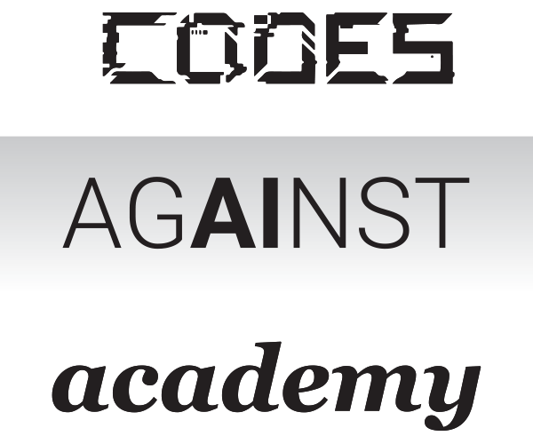

<p align="center">
  
</p>

# Codes Against Academy

**AI ethics discussion cards for schools.**

A physical (and digital) deck that gets teachers, administrators, curriculum designers, students, and parents talking — honestly — about how AI shows up in classrooms, homework, media, and school life.

<p align="center">
  
</p>

**Play online:** [codesagainstacademy.com](https://codesagainstacademy.com)  
**Buy a deck:** [Purchase](https://codesagainstacademy.com/purchase) · [Amazon](https://www.amazon.com/dp/B0FD6VKZ9K)

---

## What’s in the 2026 edition

| Piece | Count |
| --- | ---: |
| Scenario cards | **100** |
| Tier List cards (S → F) | **7** |
| Rules cards | **3** |
| **Total** | **110** |

**Five categories:** Images · Text · Learning · Video · Audio  

Scenarios are short, open-ended situations. Many are deliberately incomplete — the card holder fills in the details — so the same prompt can spark different debates with different groups.

Fifteen scenarios were AI-authored and human-edited. The rest were written by humans. After you play, you can try to **Spot the AI**.

<p align="center">
  
</p>

---

## How you play

Three modes out of the box (use them any way you like):

### 1. Tier List
Lay out the S–F tier cards. Draw a scenario, read it aloud, place it on a tier, and defend your call. The best prompt in the room is usually:

> What would have to change for this card to move up or down?

### 2. Open discussion
Skip the ranking. Pull cards by category or shuffle the whole deck. Argue about intent, audience, privacy, pedagogy, ownership, and the law.

### 3. Spot the AI
After a session, nominate which scenarios you think were AI-written. Check the reveal on the rules card. Scoring is optional — the argument is the point.

---

## Who it’s for

- Faculty meetings and PD days  
- Admin / leadership teams setting AI policy  
- Classroom discussions (age-appropriate facilitation)  
- Curriculum & instructional design workshops  
- Parent nights and board conversations  

Tagline energy: **an engaging faculty meeting in a box.**

---

## This repository

Companion **web app** for the physical deck: draw scenarios, assign tiers, unlock the full digital set, suggest ideas, and buy a real box.

| | |
| --- | --- |
| Stack | SvelteKit · static adapter · GitHub Pages |
| Deploy | Push to `main` → Actions → Pages |
| Site | [codesagainstacademy.com](https://codesagainstacademy.com) |
| Pages URL | [rootlake.github.io/codesagainstacademy](https://rootlake.github.io/codesagainstacademy) |

```bash
npm install
npm run dev      # local
npm run build    # static output in build/
```

---

## Buy / support

- **Card (Stripe):** singles $25 · Faculty Meeting Pack (10) $225 — on the [Purchase](https://codesagainstacademy.com/purchase) page  
- **Amazon:** [product listing](https://www.amazon.com/dp/B0FD6VKZ9K)  
- **PayPal / Venmo / check:** also linked from Purchase  

School POs and custom invoices: email **jlake@pomfret.org**.

---

## Contributing

Ideas welcome:

- New scenario suggestions (keep them short, specific, discussable)  
- Bug reports for the web app  
- Facilitation notes that worked with your faculty  

Open an issue or email jlake@pomfret.org.

---

## License

MIT — use it for learning, PD, and fun. The physical deck artwork and product branding remain with the project; ask before redistributing print files.
